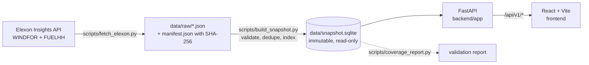

# Architecture

## Principles

- **Ingestion is explicit and offline.** The API never calls Elexon. A snapshot is built once by a script, carries the SHA-256 of the raw responses in its metadata, and is opened read-only (`mode=ro`). The demo therefore never depends on upstream availability, and every number can be traced to a specific fetch.
- **Pure core, thin edges.** `selection.py` (which forecast is eligible) and `metrics.py` (alignment and error statistics) have no I/O and no framework imports. `services.py` composes them with `db.py`; `main.py` only validates input and maps errors to HTTP codes.
- **No look-ahead, twice.** The SQL in `db.forecast_candidates` filters `publish_time <= cutoff`, and `selection.select_latest` filters again. A regression in one cannot leak a future run.
- **The URL is the state.** Every selection (view, dates, cutoff, comparison) lives in the query string. Sharing a link reproduces the view; browser back/forward work; nothing is copied into global stores. TanStack Query owns request state and cancels superseded requests.
- **Times are explicit.** Storage and API use ISO-8601 UTC. The decision cutoff and delivery day are defined in Europe/London and converted with `zoneinfo`. The frontend formats with `Intl.DateTimeFormat` pinned to Europe/London, so a viewer in any timezone sees the same hours.

## Backend layout

| File | Responsibility |
|---|---|
| `backend/app/config.py` | settings from environment, cutoff presets |
| `backend/app/db.py` | read-only SQLite connection, parameterised queries |
| `backend/app/selection.py` | decision instant, delivery window, latest-eligible-run selection |
| `backend/app/metrics.py` | hourly alignment rule, MAE/RMSE/bias/P90, MWh |
| `backend/app/services.py` | per-day evaluation, aggregation, paired comparison, CSV export |
| `backend/app/schemas.py` | Pydantic response contracts (also the OpenAPI schema) |
| `backend/app/main.py` | routes, validation, request logging, static frontend mount |

## API

| Route | Purpose |
|---|---|
| `GET /healthz` | readiness, including whether the snapshot opens |
| `GET /api/v1/metadata` | snapshot id, coverage dates, units, presets, source manifest |
| `GET /api/v1/forecast?decision_date&cutoff` | View 1: eligible forecast per hour with publish time, age and lead time. No actuals. |
| `GET /api/v1/accuracy?decision_from&decision_to&cutoff[&compare_cutoff]` | View 2: summary, daily, per-hour rows with exclusion reasons, optional paired comparison |
| `GET /api/v1/export.csv?...` | the evaluated rows, one per hour, with snapshot id and cutoff on every row |
| `GET /docs` | OpenAPI UI |

`cutoff` accepts `HH:MM` or the preset keys `epex` / `n2ex`. Invalid input returns 422 with a message; a missing snapshot returns 503; conflicting duplicate forecasts would return 409.

## Frontend layout

| Path | Responsibility |
|---|---|
| `src/state/urlState.ts` | parse/serialise the selection to the query string, `useSyncExternalStore` hook |
| `src/api/client.ts` | typed fetch + TanStack Query hooks, abort on supersede |
| `src/features/ReplayView.tsx` | View 1 |
| `src/features/AccuracyView.tsx` | View 2, daily drill-down, comparison panel, CSV link |
| `src/components/charts.tsx` | Recharts line/step and signed bar charts with custom tooltips |
| `src/components/tables.tsx` | text equivalents of every chart (accessibility and audit) |
| `src/lib/format.ts` | Europe/London formatting |

## Deployment

- **Docker**: multi-stage build (Node builds the SPA, Python serves API + static files via uvicorn). `compose.yaml` runs it on port 8000. The image honours `$PORT`, so it also runs on Heroku's container stack.
- **Vercel**: one project. The Python runtime imports `backend.app.main:app` (declared in `pyproject.toml`); `vercel.json` builds the Vite app first, and FastAPI mounts `frontend/dist` so the same function serves both. Vercel runs the function, not the Docker image.

## Observability

Each response carries `x-request-id`; API requests are logged with id, method, path, status and duration. Ingestion prints accepted/rejected counts and the snapshot id. `/healthz` reports the snapshot id or the failure reason.

## Tests

- `backend/tests/test_selection.py`: before/at/after cutoff, previous-day fallback, conflicts, irregular publish times, zero values, GMT/BST, 31 Jan boundary, DST day lengths.
- `backend/tests/test_metrics.py`: hand-calculated MAE/RMSE/bias/P90, empty samples, half-hour alignment, MWh.
- `backend/tests/test_api.py`: a synthetic snapshot with a tempting *later, perfectly accurate* run that must never be selected; coverage and exclusion reasons; paired comparison cohort; CSV reproduces the summary; input validation.
- Frontend: formatting is timezone-proof, URL state round-trips, and an App flow (replay → cutoff change → accuracy → export link, plus the error state) against a mocked API.
- CI additionally rebuilds the snapshot from the committed raw files and runs the coverage report, and smoke-tests the Docker image.
